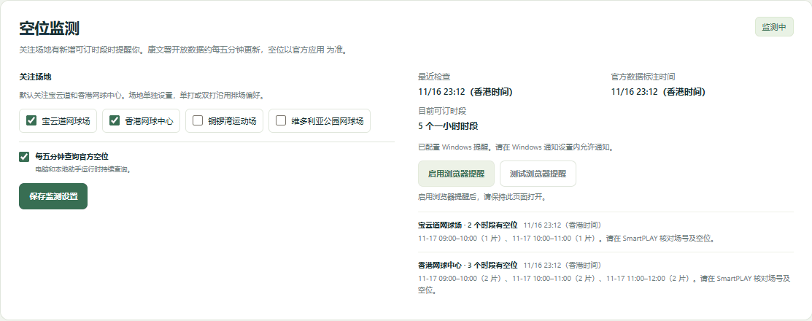

# SmartPLAY 网球排场助手

基于香港康文署公开 SmartPLAY 数据，筛选网球场空位、排列候选场次，并在关注场地出现新空位时发出本机提醒。适合关注宝云道网球场、香港网球中心及附近球场的球友。

[图文使用指南](docs/guide.md) · [下载 ZIP](https://github.com/tommyshyr/smartplay-tennis-assistant/archive/refs/heads/main.zip)

## 能做什么

| 功能 | 说明 |
| --- | --- |
| 筛选场次 | 按场地优先级、星期、时段、单打或双打、每小时预算筛选。默认优先连续两小时，并可保留一小时备选。 |
| 监测空位 | 默认关注**宝云道网球场**和**香港网球中心**。助手运行时约每五分钟查询公开数据。在两次连续且更新时间可核实的快照中，观察到同一时段从满场变为有空时发出本机提醒。 |
| 提醒放位 | 显示香港时间倒计时，并可将未来 30 天的放位提醒导入日历。 |
| 管理行程 | 手动登记已付款场次，排场时避开时间冲突，并将已登记行程导出到日历。 |

排场和监测另支持铜锣湾运动场及维多利亚公园普通网球场。以上四处均位于湾仔区。[康文署场地名单](https://www.lcsd.gov.hk/tc/programmes/programmeslist/districtsports/crsprog/listbookoffice.html)

在 [My SmartPLAY 应用或官方网页](https://www.smartplay.lcsd.gov.hk/website/tc/)登录、选场和付款。连续两小时有公开空位时，仍需在官方页面核对是否为同一个球场编号。

## 快速开始

1. 安装 [Python 3.11 或更新版本](https://www.python.org/downloads/)。下载上方 ZIP 并解压，或运行 `git clone https://github.com/tommyshyr/smartplay-tennis-assistant.git`。
2. **Windows** 双击 `Start-Windows.cmd`，也可在项目目录运行 `python launch.py`。**macOS / Linux** 在项目目录运行 `python3 launch.py`。
3. 打开 [本机助手](http://127.0.0.1:8787/)。首次使用可点「进入演示」熟悉界面。
4. 在「排场偏好」设置筛选条件，再在「空位监测」勾选关注场地、保存设置并测试浏览器提醒。
5. 点击候选场次的「去官方选场」，付款成功后回到助手登记。

监测期间保持助手运行、电脑唤醒。浏览器提醒还需要页面保持打开。首次检查、断线恢复和更改监测范围会重新建立基线。来源更新时间无法核实、已超过六分钟或通知积压时，助手暂停相应空位提醒。公开数据与官方应用之间仍可能存在时间差。助手仅监听 `127.0.0.1`，偏好、数据快照与预订记录保存在本机的 `data/assistant.sqlite3`。

**[查看完整图文使用指南](docs/guide.md)**，包括 Windows 和 macOS 启动步骤、空位通知设置、放位时间、手动导入 JSON 和常见问题。

[](docs/guide.md#3-设置空位监测与通知)

*截图使用测试样例。*

原始代码采用 [MIT 许可证](LICENSE)。公开空位数据由香港特区政府康文署通过 DATA.GOV.HK 提供。[康文署开放数据](https://data.gov.hk/tc-data/dataset/hk-lcsd-facility-facility-tcvenue) · [DATA.GOV.HK 使用条款](https://data.gov.hk/tc/terms-and-conditions)

## 运行测试

在项目目录运行：

```sh
python -m unittest discover -s tests
```

macOS 和 Linux 请将命令中的 `python` 换成 `python3`。
