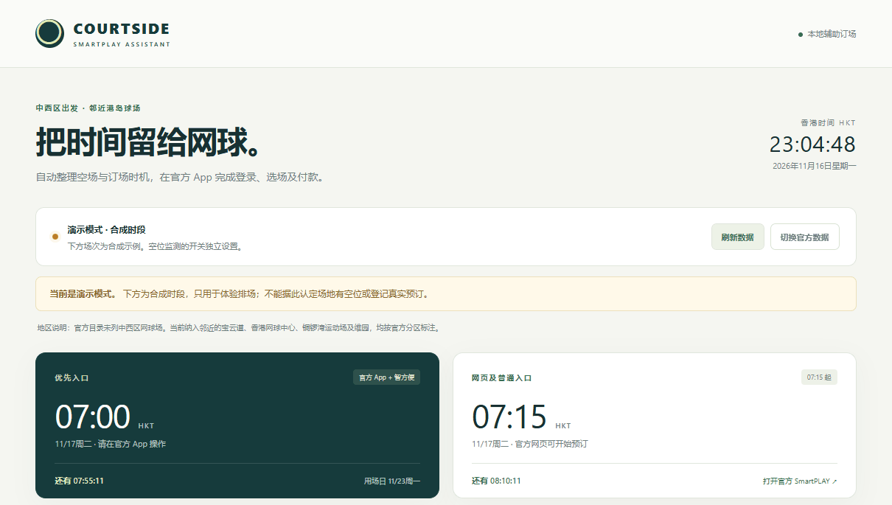
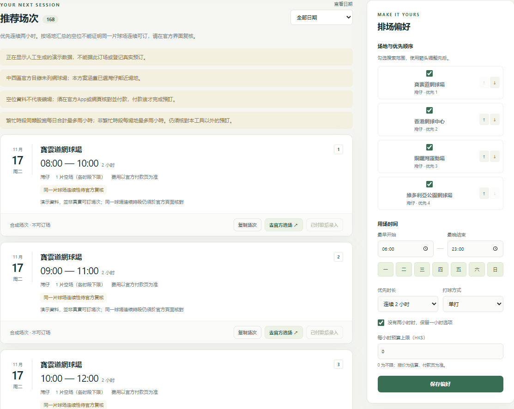
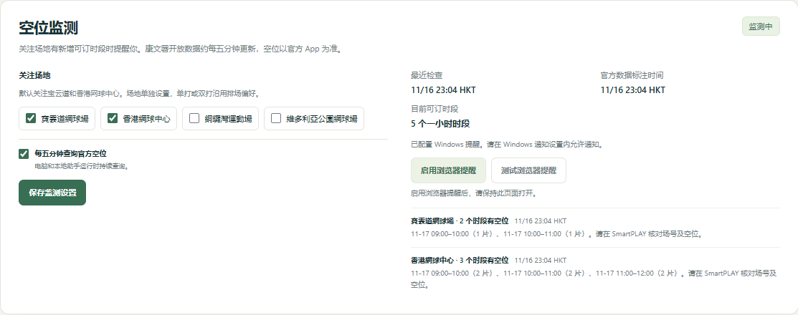
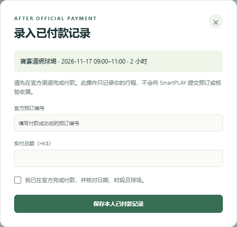
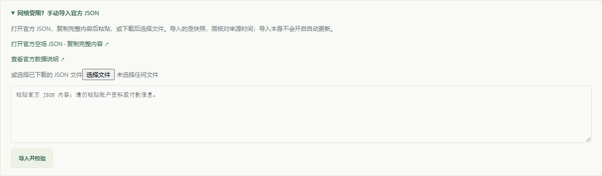

# SmartPLAY 网球排场助手使用指南

[返回项目首页](../README.md) · [English quick guide](#english-quick-guide)

本指南从安装开始，演示如何挑选场次、设置宝云道和香港网球中心的空位提醒，以及付款后把场次加入日历。**截图取自运行中的助手，使用演示数据或测试样例。截图里的场次均仅供操作示例。**

## 1. 安装并打开助手

1. 安装 [Python 3.11 或更新版本](https://www.python.org/downloads/)。Windows 安装时勾选 **Add python.exe to PATH**。已装好时可先在终端运行 `python --version`，macOS 或 Linux 用 `python3 --version`。
2. [下载项目 ZIP](https://github.com/tommyshyr/smartplay-tennis-assistant/archive/refs/heads/main.zip) 并解压，进入包含 `launch.py` 的项目文件夹。
3. 按系统启动。

   | 系统 | 启动方式 |
   | --- | --- |
   | Windows | 双击 `Start-Windows.cmd`，或在该文件夹打开 PowerShell 并运行 `python launch.py`。 |
   | macOS | 在终端进入项目文件夹，运行 `python3 launch.py` 或 `sh Start-Mac.command`。 |
   | Linux | 在终端进入项目文件夹，运行 `python3 launch.py`。 |

4. 在启动电脑的浏览器打开 [http://127.0.0.1:8787/](http://127.0.0.1:8787/)。保留终端窗口，按 `Ctrl+C` 可停止助手。

第一次可以点击页面上方的 **进入演示**。界面会标明「演示模式」，方便练习筛选。正式监测前点击 **切换官方数据**。

## 2. 筛选并核对场次

1. 在 **排场偏好** 勾选要考虑的球场。用箭头调整优先级，例如把宝云道排在香港网球中心之前。
2. 设置可打球的星期和时间区间，例如周六、周日 09:00–12:00。选择「连续 2 小时」或「1 小时」，并选择单打或双打。勾选「没有两小时时，保留一小时选项」可获得备选。每小时预算填 `0` 表示不限，实际费用以 SmartPLAY 为准。
3. 点击 **保存偏好**。在 **推荐场次** 用「查看日期」缩小范围，点击 **复制场次** 记下场地、日期和时间，或点击 **去官方选场** 打开官网。
4. 在官方 App 或网页按场地、日期和时间查询。**如果打算订连续两小时，核对两节是否为同一个球场编号。** 公开数据只给出场地及设施类型的空位数量。核对场号、时间和费用后，在官方页面付款。

## 3. 设置空位监测与通知

1. 在 **空位监测** 勾选要关注的场地。默认是**宝云道网球场**和**香港网球中心**。
2. 勾选 **每五分钟查询官方空位**，点击 **保存监测设置**。切换到官方数据后，等待状态显示 **监测中**，再查看「最近检查」「官方数据标注时间」和「目前可订时段」。
3. 点 **启用浏览器提醒**，在浏览器弹窗选择允许，再点 **测试浏览器提醒**。浏览器需要保持页面打开。Windows 原生桌面提醒可在浏览器关闭时送达，前提是助手仍在运行、电脑唤醒，且 Windows 允许通知。
4. 在面板下方查看最近提醒，按提醒中的场地、日期和时段去 My SmartPLAY 核对实际空位。

监测按**单打或双打偏好**匹配一小时时段，独立于排场页的星期、时间、预算和两小时时长筛选。首次成功读到数据时，已有空位可能触发提醒。同一时段持续有空时只提醒一次。官方数据约每五分钟更新，时段可能在两次更新之间被订走。

## 4. 添加放位日历提醒

以下均为香港时间。七天预订期包含预订当天，例如周一放出同一周周日的普通场次。

| 时间 | 可以做什么 |
| --- | --- |
| 06:55 | 助手的准备提醒，提前打开官方 App 和「智方便」。 |
| 07:00 | 通过「智方便」登录 My SmartPLAY App 使用优先入口。符合条件的未满 11 岁用户可按康文署公布的安排使用 App。 |
| 07:15 | 可使用 SmartPLAY 网页、普通 App 登录、自助服务站或服务柜台。 |

在 **放位前准备** 点击 **添加放位日历提醒**，下载未来 30 天的 `.ics`，导入手机或电脑日历并确认通知已开启。页面顶部的倒计时也显示下次放位时间与对应的用场日期。[康文署放位公告](https://www.info.gov.hk/gia/general/202607/03/P2026070300278.htm)

## 5. 在官方付款后登记行程

回到对应候选场次，点击 **已付款后录入**。填入官方预订编号和实付总额，核对日期、时段、球场后勾选确认，再点 **保存本人已付款记录**。在 **已付款记录** 点击 **导出行程**，可以下载已登记场次的日历文件。

助手使用本地记录避免推荐时间冲突。修改或取消官方预订请在官方渠道操作。导出的日历文件可能包含你填入的官方预订编号。

## 6. 读取数据状态与手动导入

| 页面状态 | 可以怎么用 |
| --- | --- |
| 官方开放数据 · 非实时锁场 | 可用于筛选场次。以最近检查时间判断数据新旧，下单前再到官方 App 核对。 |
| 手动导入快照 · 非自动更新 | 可用于排场。想用更新的快照时重新导入，空位提醒依赖助手恢复自动取数。 |
| 旧数据 · 请先刷新并在官方复核 | 查看上一份快照，等待自动重试，或导入新的官方 JSON。 |
| 官方数据暂不可用 | 可先检查网络、打开官方 App 核对，或按下文导入。 |
| 演示模式 · 合成时段 | 可练习排场和查看候选卡片。正式使用前点「切换官方数据」。 |

如果助手连不上公开数据，但浏览器能打开官方文件：

1. 展开页面底部 **网络受限？手动导入官方 JSON**。
2. 点击 **打开官方空场 JSON**。将完整响应复制到文本框，再点 **导入并校验**。也可以下载原始 `.json` 文件，点 **或选择已下载的 JSON 文件**，选中后助手会自动尝试导入。
3. 回到页面顶部确认显示 **手动导入快照**，再查看推荐场次。检查数据获取时间和用场日期。使用官方 App 核对未显示的场地或时段。[官方空场 JSON](https://data.smartplay.lcsd.gov.hk/rest/cms/api/v1/publ/contents/open-data/tennis/file)

### 常见问题

| 情况 | 检查方法 |
| --- | --- |
| 打不开 `127.0.0.1:8787` | 确认在启动助手的电脑上打开页面。查看终端是否报错，检查 Python 版本和 `8787` 端口是否已被占用。 |
| 监测显示「等待官方数据」或「暂未取得可用数据」 | 确认关注场地已勾选并保存，已切回官方数据，并查看顶部网络状态。手动导入可继续排场，自动取数恢复后才会重新产生空位提醒。 |
| 测试通知弹不出来 | 检查该本机站点的浏览器通知权限和电脑系统通知设置。实际监测还需要助手运行、电脑保持唤醒。 |
| 没有推荐场次 | 清除日期筛选，放宽时段或预算，开启一小时备选，检查单双打设置和数据状态，再到官方 App 核对。 |
| 关闭窗口后还有提醒吗 | 关闭浏览器会停止浏览器提醒。Windows 原生提醒可以继续运行，前提是助手终端仍开着且电脑没有睡眠。放位日历提醒由你的日历应用管理。 |

## English quick guide

1. **Install and run.** Install Python 3.11+, extract the ZIP, and run `python launch.py` on Windows or `python3 launch.py` on macOS or Linux. Open [the local app](http://127.0.0.1:8787/) on that computer. **进入演示** starts demo mode and **切换官方数据** switches back. [Dashboard screenshot](#1-安装并打开助手)
2. **Plan a session.** Under **排场偏好**, choose venues, their priority, weekdays, time, play type, duration and hourly budget. **保存偏好** saves. Use **推荐场次** to filter dates and **复制场次** to copy a candidate. Verify the same court number for consecutive hours when booking in My SmartPLAY. [Planner screenshot](#2-筛选并核对场次)
3. **Watch openings.** Under **空位监测**, select venues and enable **每五分钟查询官方空位**, then click **保存监测设置**. Allow and test browser notifications with **启用浏览器提醒** and **测试浏览器提醒**. Keep the app running and your computer awake. Browser alerts also require the page to remain open. [Monitor screenshot](#3-设置空位监测与通知)
4. **Export release reminders.** Click **添加放位日历提醒** to import the next 30 days into your calendar. In Hong Kong time, priority app access starts at 07:00 and regular access starts at 07:15. [Release schedule](#4-添加放位日历提醒)
5. **Record after payment.** Book and pay in SmartPLAY. Click **已付款后录入**, enter the official reference and amount paid, then save the local record. Use **导出行程** to download the booking calendar. [Booking form screenshot](#5-在官方付款后登记行程)
6. **Import a snapshot.** If automatic fetching fails, expand **网络受限？手动导入官方 JSON**. Paste the complete official JSON and click **导入并校验**, or select the downloaded file. Imported snapshots support planning. New availability alerts require automatic fetching to recover. [Import screenshot and troubleshooting](#6-读取数据状态与手动导入)
